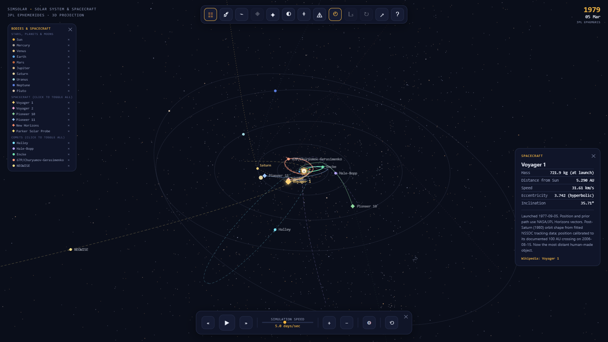
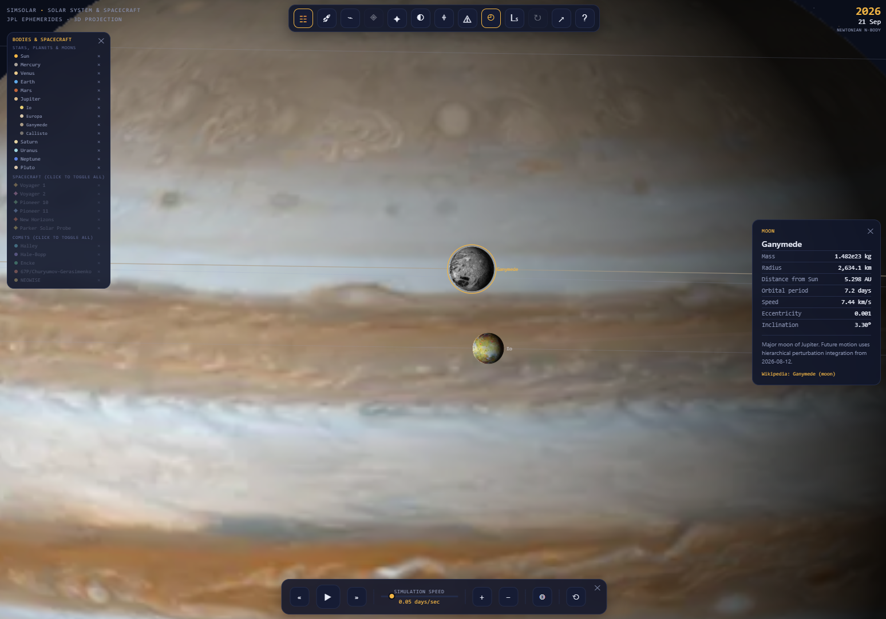
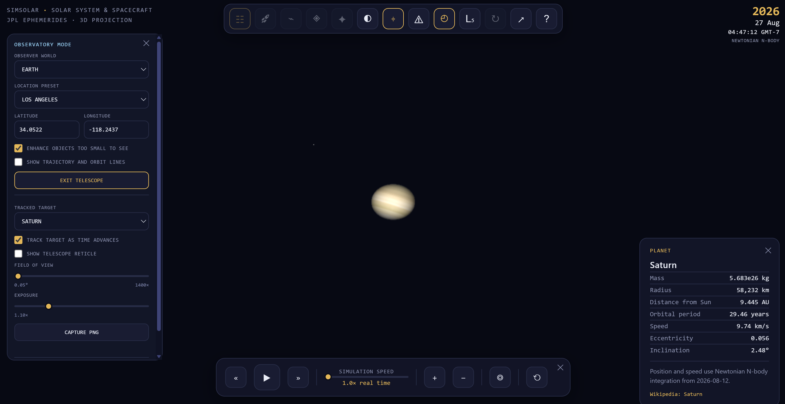
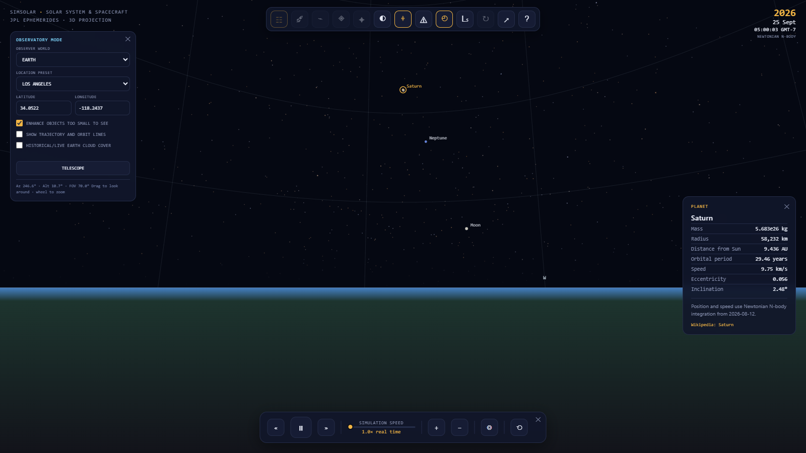
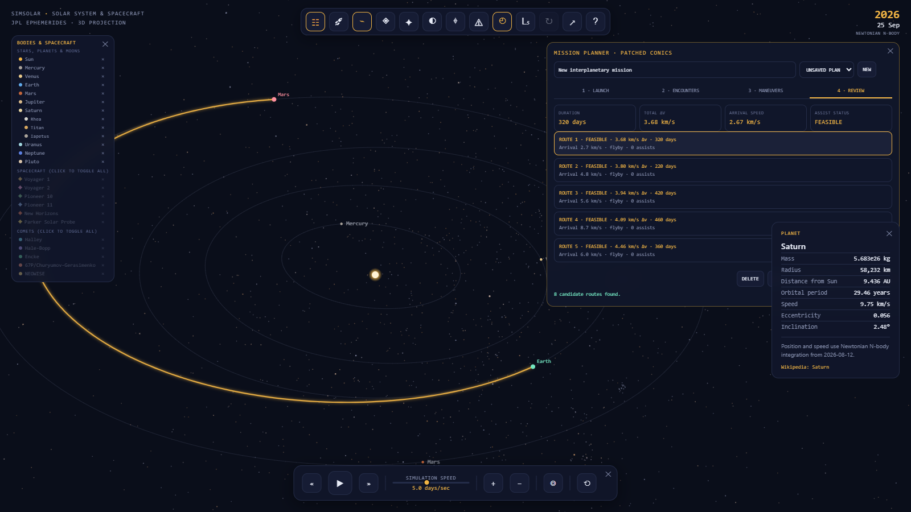
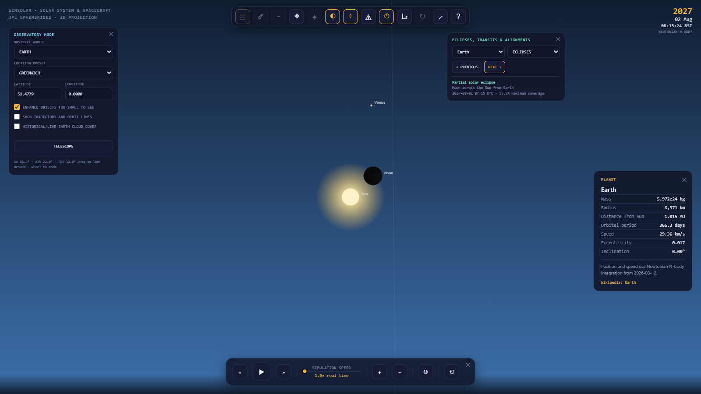
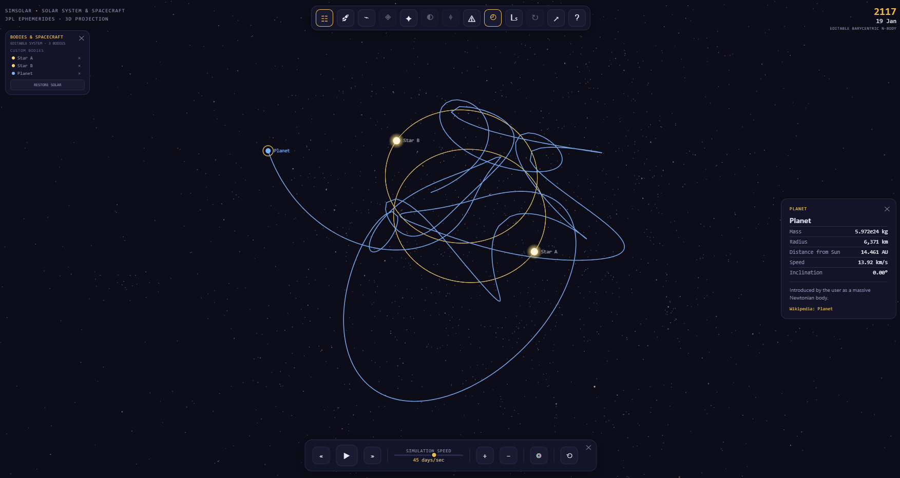
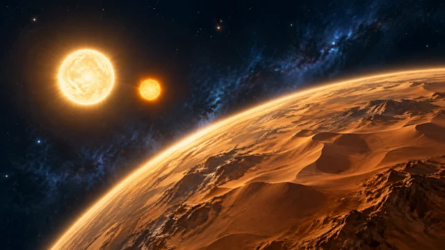

# SimSolar

<p align="center">
  <strong>An interactive solar-system, spacecraft, and gravity simulator that runs entirely in your browser.</strong>
</p>

<p align="center">
  <a href="https://miroslavplese.github.io/simsolar/"><strong>Launch SimSolar</strong></a>
  ·
  <a href="#explore-simsolar">Explore the highlights</a>
  ·
  <a href="#run-locally">Run locally</a>
</p>

<p align="center">
  <a href="https://miroslavplese.github.io/simsolar/">
    
  </a>
  <br>
  <em>Historic spacecraft missions and iconic comet paths in the standard Solar System view.</em>
</p>

SimSolar combines NASA/JPL ephemerides, interactive 3D projection, historical
mission paths, future Newtonian N-body integration, surface observation, and
mission planning in a dependency-free web app. Explore the real Solar System or
load a curated star system, then experiment with editable stars, black holes,
planets, and comets.

The built-in Solar System overview includes a schematic main asteroid belt
between Mars and Jupiter. Its exaggerated particles illustrate the belt's
distribution, not measured asteroid positions or simulated gravitational bodies.
The belt is absent from custom/editable systems.

## Explore SimSolar

<table>
  <tr>
    <td width="50%" valign="top">
      
      <br>
      <strong>Planet and moon close-ups</strong><br>
      Zoom from the outer Solar System down to textured planets, rings, moving
      moon shadows, and 13 major moons with hierarchical dynamics.
    </td>
    <td width="50%" valign="top">
      
      <br>
      <strong>Tracked telescope mode</strong><br>
      Observe a target from a planetary surface with adjustable field of view,
      exposure, automatic tracking, an optional reticle, and clean PNG capture.
    </td>
  </tr>
  <tr>
    <td width="50%" valign="top">
      
      <br>
      <strong>Surface observation</strong><br>
      Stand on Earth, another solid world, a major moon, or a custom planet.
      Choose coordinates, identify planets in the night sky, accelerate time,
      and optionally reveal orbit and trajectory guides.
    </td>
    <td width="50%" valign="top">
      
      <br>
      <strong>Interplanetary mission planning</strong><br>
      Search launch and arrival windows, add gravity assists, compare ranked
      Lambert routes, inspect maneuvers, preview a flight, or enter the
      spacecraft cockpit.
    </td>
  </tr>
  <tr>
    <td width="50%" valign="top">
      
      <br>
      <strong>Eclipse, transit, and alignment search</strong><br>
      Find the next or previous event visible from a selected world, jump to
      its exact time, and inspect the geometry directly from the observer's
      surface.
    </td>
    <td width="50%" valign="top">
      
      <br>
      <strong>Editable N-body systems</strong><br>
      Replace the Solar System with stars, black holes, planets, and comets,
      then follow their barycentric trajectories, close encounters, and
      collisions.
    </td>
  </tr>
  <tr>
    <td width="50%" valign="top">
      
    </td>
    <td width="50%" valign="top">
      <strong>Curated star systems</strong><br>
      Load nine ready-to-explore systems, from Tatooine's twin suns and
      idealized binary experiments to illustrative models of TRAPPIST-1,
      Kepler-16, and other observed systems. Follow their N-body motion,
      observe from a planet, or edit the model. Return to the original Solar
      preset at any time.<br>
      <em>Tatooine artwork is an artistic impression, not an observation or
      a to-scale simulation screenshot.</em>
    </td>
  </tr>
</table>

## Features

### Explore and observe

- Eight planets, Pluto and Charon, 13 major moons, ten spacecraft, and
  five comets with NASA/JPL-derived positions and trajectories
- Lazy-loaded planetary textures with axial rotation, physical-scale close
  rendering, illumination, Earth clouds, moving moon shadows, depth-aware
  occultation, and shadowed planetary rings
- A camera-relative sphere of 8,870 Hipparcos stars with catalog positions,
  Johnson V magnitudes, B−V colors, and a cached offscreen backdrop
- Surface Observatory Mode for solid planets, moons, and custom planets with
  location presets, configurable coordinates, atmospheric daylight, horizon
  coordinates, true angular sizes, local civil time, and optional projected
  orbit and trajectory guides
- Optional live or historical Earth cloud cover using Open-Meteo forecasts and
  ECMWF ERA5 reanalysis
- Telescope mode with target tracking, a 0.05–10° field of view, fine aiming,
  exposure control, optional reticle, planetary rings, and PNG capture
- Eclipse, planetary transit, and one-degree planet-conjunction search with
  direct navigation to the event in Observatory Mode
- Selectable L1–L5 markers and co-rotating Sun-planet or planet-moon frames

### Missions and trajectories

- Mission timeline with launch and flyby jumps, UTC date navigation, automatic
  focus, object following, and physical information cards
- Patched-conic mission planner with Earth parking-orbit injection, ranked
  Lambert routes, optional finite-periapsis gravity assists, destination flyby
  or orbit insertion, maneuver details, animated previews, local saves, and
  shareable plans
- Spacecraft View for riding a planned mission with a velocity-aligned cockpit,
  free-look and field-of-view controls, live telemetry, progress milestones,
  selectable encounter bodies, time acceleration, and shareable cockpit state
- Clickable planet, spacecraft, and comet paths, with incrementally sampled
  future trails that remain responsive through close encounters

### Physics and experimentation

- Worker-backed live global/moon integration, collision refinement, and future
  date navigation over HTTP(S), with the displayed clock synchronized to
  completed states and a cooperative direct-file fallback
- Elliptical and hyperbolic Kepler solvers plus future-only barycentric
  Newtonian N-body gravity initialized from exact JPL state vectors
- Hierarchical major-moon integration with external tides, mutual moon
  perturbations, parent recoil, checkpoints, and custom-body gravity
- Interactive insertion of stars, black holes, planets, and comets with
  configurable properties and 0–180° orbital inclination
- Editable star systems with blank-system creation, direct camera navigation,
  per-body and cascading deletion, barycentric evolution, and Solar preset
  restoration
- A curated library of nine systems: Our Solar System, Tatooine, Alpha Centauri,
  TRAPPIST-1, Kepler-16, HD 189733, Binary Duet, Kepler-442, and Compact Four.
  Each selector card has locally bundled AI-generated raster artwork (not to scale).
  The non-Solar planets and stars have matching generated surface textures and
  raster info-panel portraits labeled "Artistic illustration"; the Solar preset
  retains its existing observation-based maps and reference photographs.
  Info-panel values distinguish arbitrary assumptions, approximate references,
  estimates, and simulation results, including Alpha Centauri's demo-scale orbits.
  Loading resets the clock to the current time, pauses playback, fits the view,
  and clears system-specific tools and accumulated calculations/trajectories.
  Restore Solar also starts fresh at the current time; saved scenario links
  retain their recorded dates.
  The Solar entry restores the original preset; the other entries are editable,
  explicitly illustrative N-body models with barycentric stellar orbit guides.
- Physical-scale custom-body rendering in both system and Observatory views,
  including custom planets as observer worlds
- Swept-contact detection, predicted-impact warnings, deterministic
  close-encounter substeps, and momentum-conserving custom-body merging

### Interaction and sharing

- Animated simulation clock with adjustable speed and direction, responsive
  orbit rotation, right-button or two-finger panning, pinch/wheel zoom, movable
  panels, and Inner/Outer/Deep view presets
- Versioned scenario links that restore time, playback, camera, visible layers,
  selection, follow target, Observatory/telescope state, planned missions, and
  compact custom systems
- First-run guided tutorial with persistent completion and an always-available
  restart button
- Selection cards with physical and orbital data plus Wikipedia links
- Reference images for all 39 built-in objects, bundled from Wikipedia/Wikimedia
  with clickable source links and attribution tooltips; custom objects and Lagrange points
  have explicitly labeled schematics
- Recent mission trajectories and milestones for the James Webb Space Telescope,
  Lucy, Psyche, and Europa Clipper, alongside the six original missions
- Rolling average and p95 frame-time profiler for every view preset
- Keyboard shortcuts for major tools: `V` Spacecraft View, `W` mission planner,
  `M` mission timeline, `L` bodies, `T` time/view controls, `E` event search,
  `O` Observatory Mode, `G` Lagrange points, `R` rotating frame, and `P`
  profiler

## Run locally

Open `solar-system.html` in a modern browser. No build, package installation, or
web server is required.

To use Web Workers for live simulation and mission-route search, serve the
repository over HTTP(S). With Node installed, run `node tools/serve.js` and open
`http://127.0.0.1:4173/solar-system.html`. Direct-file launch instead uses
cooperative execution on the main thread.

## Repository layout

| Path | Purpose |
| --- | --- |
| `solar-system.html` | Static page shell and ordered script loading; still opens directly |
| `src/app.js` | Composition root: explicit dependencies, initialization, scenario restore, and page lifecycle |
| `src/app/` | Catalog instances, simulation state, playback, camera, selection, input, system transitions, and animation |
| `src/rendering/` | Canvas viewport, visibility, stars, surfaces, orbits, rings, overlays, and three scene renderers |
| `src/features/` | Feature controllers and their styles: body list, planner, timeline, sky events, observatory/clouds, cockpit, editing, impacts, sharing, tutorial, panels, and profiler |
| `src/app.css` | Shared tokens, page layout, controls, panel utilities, and mode visibility |
| `src/features/body-info.js`, `src/features/body-info.css` | Body-card presentation, provenance, reference links, imagery lifecycle, and responsive styling |
| `src/spacecraft-catalog.js` | Mission metadata, links, and timeline milestones |
| `src/scenario-controller.js` | Validated scenario restoration and share-link coordination |
| `src/work-scheduler.js`, `src/playback-clock.js` | Cooperative work budgets and visibility-aware playback timing |
| `src/mission-search.js`, `src/mission-worker.js` | Worker-based route search with direct-file cooperative fallback |
| `src/simulation-engine.js`, `src/simulation-client.js`, `src/simulation-worker.js` | Exact live physics snapshots, off-thread execution, cancellation, and direct-file fallback |
| `src/object-images.js` | Selection-scoped reference images, attribution, and schematic fallbacks |
| `data/recent-spacecraft-trajectories.js` | JPL vectors for Webb, Lucy, Psyche, and Europa Clipper |
| `assets/objects/credits.json`, `data/object-images.js` | Image provenance, licenses, and browser manifest |
| `data/planet-ephemerides.js` | Generated NASA/JPL Horizons planet state vectors |
| `data/planet-cutoff-states.js` | Exact NASA/JPL Horizons future-integration seed vectors |
| `data/moon-cutoff-states.js` | Generated NASA/JPL Horizons major-moon cutoff vectors |
| `data/spacecraft-trajectories.js` | Generated NASA/JPL Horizons trajectory samples |
| `data/comet-ephemerides.js` | Generated NASA/JPL Horizons comet state vectors |
| `data/hipparcos-stars.js` | Generated naked-eye Hipparcos star catalog from CDS VizieR |
| `docs/DESIGN.md` | Architecture, data model, numerical assumptions, and design decisions |
| `docs/DEVELOPMENT.md`, `AGENTS.md` | Contributor/agent workflow, validation, performance comparisons, and baseline review |
| `docs/ROADMAP.md` | Progress tracker and prioritized improvement backlog |
| `src/trajectory-math.js` | Shared interpolation and two-body propagation module |
| `src/mission-timeline.js` | Shared mission navigation helpers |
| `src/mission-planner.js` | Lambert solver, patched-conic route scoring, window search, and plan persistence |
| `src/mission-planner-ui.js` | Mission-planner workflow, route comparison, maneuvers, saves, and previews |
| `src/body-select.js` | Shared hierarchical body dropdowns with planet/moon families and custom-system relationships |
| `src/spacecraft-view.js` | Planned-flight camera frame, projection, leg selection, and telemetry |
| `src/frame-profiler.js` | Rolling frame-time statistics for view presets |
| `src/view-transform.js` | Camera rotation and view-space transformation helpers |
| `src/star-field.js` | Deterministic celestial-sphere generation and camera projection |
| `src/observatory-mode.js` | Surface frames, horizontal coordinates, sky projection, and daylight calculations |
| `src/scenario-state.js` | Validated versioned encoding for shareable URL scenarios |
| `src/system-model.js` | Editable-system identity, deletion, lighting, catalog, and validation helpers |
| `data/curated-systems.js`, `src/curated-systems-ui.js` | Curated examples, orbital-state initialization, and library panel; loading is coordinated by `src/app/system-transitions.js` |
| `src/guided-tutorial.js` | First-run persistence and responsive guided walkthrough UI |
| `src/panel-drag.js` | Pointer-driven movable panel behavior and viewport clamping |
| `src/body-rendering.js` | Marker-to-physical-radius close-view transitions |
| `src/body-textures.js` | Lazy WebGL sphere projection and texture loading |
| `src/body-placement.js` | Inclined custom-body velocity and orbital-plane calculations |
| `src/body-lighting.js` | Lambert sphere lighting and geometric shadow tests |
| `src/moon-system.js` | Major-moon metadata and visibility thresholds |
| `src/hierarchical-moon-simulation.js` | Perturbed parent-moon hierarchy integration |
| `src/ring-system.js` | Physical ring bands and 3D equatorial-plane geometry |
| `src/lagrange-system.js` | Restricted three-body L1-L5 calculations and frame alignment |
| `src/occultation-system.js` | Apparent-disk overlap geometry and event refinement |
| `src/nbody-simulation.js` | Barycentric Newtonian integration and checkpoint replay |
| `tests/trajectory-tests.js` | Dependency-free numerical regression suite |
| `tests/mission-planner-tests.js` | Lambert, flyby, route search, sampling, and persistence tests |
| `tests/mission-planner-ui-tests.js` | Planner date, duration, and default-plan tests |
| `tests/spacecraft-view-tests.js` | Cockpit camera, projection, leg, and telemetry tests |
| `tests/star-field-tests.js` | Star generation and camera-relative projection tests |
| `tests/observatory-mode-tests.js` | Surface-frame and horizontal sky-projection tests |
| `tests/scenario-state-tests.js` | Shareable scenario encoding, URL, and validation tests |
| `tests/system-model-tests.js` | Editable-system deletion, lighting, catalog, and validation tests |
| `tests/curated-systems-tests.js` | Curated catalog validation, orbital elements, binary geometry, and 100-day conservation tests |
| `tests/guided-tutorial-tests.js` | Tutorial completion cookie and fallback persistence tests |
| `tests/panel-drag-tests.js` | Movable-panel interaction and clamping tests |
| `tests/body-rendering-tests.js` | Physical radius scaling and transition tests |
| `tests/body-texture-tests.js` | Texture thresholds, rotation, and metadata tests |
| `tests/body-placement-tests.js` | Custom-body inclination and velocity-rotation tests |
| `tests/body-lighting-tests.js` | Illumination and planet-shadow geometry tests |
| `tests/moon-system-tests.js` | Moon orbit, visibility, and focus-zoom tests |
| `tests/hierarchical-moon-tests.js` | Moon conservation, perturbation, continuity, and stability tests |
| `tests/ring-system-tests.js` | Planetary ring dimensions and projection tests |
| `tests/lagrange-system-tests.js` | Collinear, triangular, and rotating-frame tests |
| `tests/occultation-system-tests.js` | Eclipse, transit, overlap, and event-search tests |
| `tests/nbody-tests.js` | Conservation, continuity, and deterministic replay tests |
| `tools/fetch-trajectories.py` | Reproducible Horizons data generator |
| `tools/fetch-stars.py` | Reproducible Hipparcos catalog generator |

## Current limitations

- Historical dates use ephemerides rather than recomputing past gravitational
  interactions.
- Historical spacecraft positions and flybys use bundled NASA/JPL Horizons
  vectors through the date recorded in the generated data file.
- Planet, Pluto, and Charon markers use matching NASA/JPL Horizons state vectors
  from 1970 through 2035 so they align with historical launches and flybys.
- Comet paths use Horizons state vectors from 1950 through 2080.
- Dates beyond the bundled spacecraft vectors are propagated from the final JPL
  position and velocity under solar gravity only until the common N-body
  cutover epoch.
- Future gravity is Newtonian. Custom-body contacts are detected using estimated
  physical radii; impacts with natural bodies are report-only and custom-body
  merges conserve mass and linear momentum. Custom massive bodies trigger
  deterministic close-encounter substeps during fast flybys. Relativistic
  effects, singularity regularization, fragmentation, maneuvers, and comet
  outgassing are not modeled.
- Historical major-moon positions are two-body continuations from authoritative
  cutoff vectors; historical planetary and mutual perturbations are not replayed.
- Future moon dynamics cover 13 major moons. Omitted satellites remain absorbed
  into each parent system's gravitational parameter.
- Eclipse, transit, and conjunction searches use the configured surface
  observer. Atmospheric refraction and formal contact times are not yet modeled.
  Event-search observers are limited to built-in Solar planets and moons;
  non-Solar curated systems disable these controls.
- Planet metadata remains in the application coordinator; spacecraft metadata
  is in a separate catalog.
- Star positions are Hipparcos ICRS catalog directions at epoch J1991.25;
  proper motion and long-term precession are not yet applied.
- Dynamic body positions and traveled trails are rendered every animation frame,
  except that off-screen heliocentric paths are suppressed in close moon views.
- Planned transfers use zero-revolution heliocentric patched conics. Major moons
  are treated as heliocentric encounter points rather than receiving a separate
  parent-system capture leg, and finite burns, low-thrust flight, launch-site
  geometry, navigation uncertainty, and multi-revolution Lambert solutions are
  not modeled.
- Custom-system links are limited to 4096 encoded characters. Large systems
  remain usable in the current browser session but must be simplified before
  they can be shared by URL.
- Custom planets use a generic airless, zero-tilt surface with a 24-hour
  rotation and generic coordinate presets.
- Non-Solar curated systems are not observed ephemerides. Their rounded
  parameters, synthetic phases and inclinations, compressed Alpha Centauri
  separations, and fictional examples are described in
  [Design: curated systems](docs/DESIGN.md#curated-systems).
  Their explicitly enabled observing surfaces are schematic, including for gas
  giants; built-in Solar gas giants remain ineligible as surface observers.
  Current orbital elements and guides are instantaneous two-body estimates,
  not predictions of an unchanging orbit in a perturbed multi-body system.
- Optional Earth cloud cover uses hourly Open-Meteo forecasts or ECMWF ERA5
  historical reanalysis from 1940 onward and requires an internet connection.
- Illumination, comet tails, and occultation tools use the most massive active
  luminous body. Secondary stars contribute gravity and render as stars but do
  not yet add separate light sources.
- Custom-system patched-conic planning treats the active massive system as a
  central barycentric gravity source; strongly non-central binary-star routes
  require full N-body mission planning.
- Chromium interaction tests and Windows raster baselines cover representative
  workflows. Firefox/WebKit, real-device testing, and broad performance coverage
  remain future work.
- The interface has limited keyboard and screen-reader support.

## Hybrid gravity model

Historical dates use bundled JPL ephemerides. At
`2026-08-12 00:00:00 UTC`, JPL-backed position and velocity vectors initialize
from exact cutoff samples rather than sparse-ephemeris interpolation. Planetary
systems are represented globally
by their system barycenters. A nested 0.05-day moon integrator combines exact
parent-moon Kepler drift with external tidal, mutual-moon, and parent-recoil
kicks. Spacecraft and comets remain massless test particles. Checkpoints provide
deterministic future navigation. Editing detaches the sampled Solar state into
one editable barycentric system, where custom massive bodies perturb its other
massive bodies and particles. Long jumps are prepared in bounded chunks so the
browser can repaint progress between them. Adaptive substeps resolve
Newtonian custom-body flybys, but relativistic compact-object encounters
remain deferred. The browser UI caps untouched Solar navigation at 2100 to
bound integration time and checkpoint memory; editable systems use their own
epoch and time bounds.

Mission searches run in a Web Worker when served over HTTP(S), or cooperatively
when opened directly from disk. Live global/moon integration, collision
refinement, and future date-input jumps run in a separate persistent simulation
Worker over HTTP(S). Rendering uses completed snapshots: the displayed clock,
bodies, and collision handling stay synchronized, and extreme acceleration
slows down when computation cannot keep up rather than freezing controls.
Direct-file launch uses the same engine cooperatively, yielding at an 8 ms
wall-clock budget between complete integration steps without changing numerical
timesteps. A single expensive step or collision refinement can exceed that
fallback budget. Arbitrary-date analysis for planning and sky-event searches
retains the reference samplers on the main thread. Hidden-tab time is not
replayed on return. Reduced-motion preferences disable initial autoplay, but
explicit playback and shared scenarios still work.

Recent mission data ends at the same August 2026 cutover as the original data.
Webb station-keeping, Psyche ion thrust, and subsequent planned burns are **not**
modeled by future Newtonian trajectories. Horizons records may include
mission-reference predictions as well as reconstructed tracking solutions.

## Contributing

Read the [development guide](docs/DEVELOPMENT.md) before making changes. It
documents architecture boundaries, validation commands, performance comparisons,
reference-update rules, and lessons from previous regressions.
[AGENTS.md](AGENTS.md) points coding agents to the same workflow.

## Test

Quick validation:

```text
npm test
```

For browser workflows:

```text
npm ci
npx playwright install chromium
npm run test:all
```

The browser suite starts its own loopback-only static server. It exercises
HTTP and direct-file launch, v1/v2/v3 links, mission planning and cockpit
restoration, observatory/telescope controls, editable systems, mobile controls,
recent missions, image loading/failure/offline behavior, and future navigation.
GitHub Actions runs coverage/functional checks on Linux, visual baselines on
Windows, and paired sustained-playback performance comparisons on Ubuntu 24.04.
It retains coverage, lifecycle measurements, performance evidence, and traces.

### Refactor regression baseline

The full [validation and baseline policy](docs/DEVELOPMENT.md#validation-commands)
now lives in the development guide. It covers numerical/visual tolerances,
resource budgets, coverage limitations, and explicit reference review.

For rendering or per-frame changes, also run
[`npm run test:performance`](docs/DEVELOPMENT.md#performance-regression-gate)
with `SIMSOLAR_PERF_BASE` set to a reviewed pre-change Git revision. The suite
compares overview playback, close-up following with spacecraft/comets enabled,
and compact curated-system playback on the same runner. Functional and visual
success alone do not establish acceptable performance.

## Refresh trajectory data

Run:

```text
python tools/fetch-trajectories.py
```

The generator downloads heliocentric Ecliptic J2000 vectors from NASA/JPL
Horizons and rewrites the legacy spacecraft, planet, comet, and cutoff datasets.
To refresh only the four recent missions without changing the legacy datasets:

```text
python tools/fetch-trajectories.py --recent-only
```

To refresh attributed object thumbnails:

```text
python tools/fetch-object-images.py
```

Use `--resume` to retain successfully downloaded image entries after a failed
request. The image generator rejects unverified licenses; inspect any changed
Wikipedia lead image before choosing an alternative. Images load only when their
object is selected and work offline. Clicking an image opens its original source
page; its tooltip retains author, license, and thumbnail-change notices.
Full attribution is also preserved in
`assets/objects/credits.json`. Earth uses NASA's Apollo 17 Blue Marble rather than
the changing article lead image. Some spacecraft images are artist illustrations.
Internet access is needed for regeneration, not for ordinary simulation or cards.
